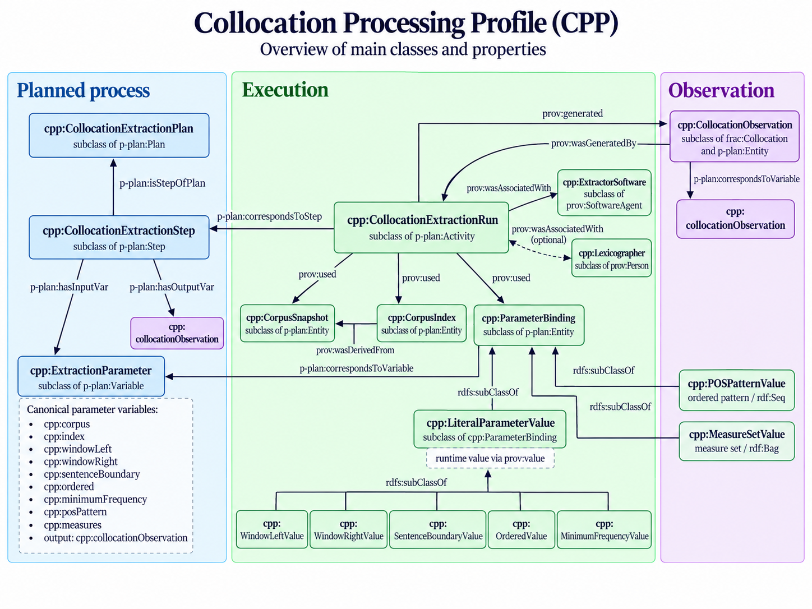

# Structure of the Collocation Processing Profile (CPP)

This note provides a concise description of the structure of **CPP**, based on the ontology file `cpp.owl` and on the overview diagram.

## 1. Planned process

The **planned process** captures the abstract methodological design of collocation extraction.

Its core elements are:

- **`cpp:CollocationExtractionPlan`** — a subclass of `p-plan:Plan`, representing the overall extraction plan.
- **`cpp:CollocationExtractionStep`** — a subclass of `p-plan:Step`, representing the planned step that performs collocation extraction.
- **`cpp:ExtractionParameter`** — a subclass of `p-plan:Variable`, representing methodologically relevant input parameters.

The canonical parameter variables defined in the ontology are:

- `cpp:corpus`
- `cpp:index`
- `cpp:windowLeft`
- `cpp:windowRight`
- `cpp:sentenceBoundary`
- `cpp:ordered`
- `cpp:minimumFrequency`
- `cpp:posPattern`
- `cpp:measures`
- output: `cpp:collocationObservation`

The step `cpp:extractCollocations` belongs to the plan `cpp:collocationExtractionPlan` and declares the above variables through `p-plan:hasInputVar` and `p-plan:hasOutputVar`.

## 2. Execution

The **execution** layer describes a concrete run of the extraction process.

Its core elements are:

- **`cpp:CollocationExtractionRun`** — a subclass of `p-plan:Activity`, representing one concrete execution.
- **`cpp:CorpusSnapshot`** — the corpus resource or corpus snapshot used by the run.
- **`cpp:CorpusIndex`** — the concrete index used by the run and derived from a corpus snapshot.
- **`cpp:ParameterBinding`** — an execution-time entity that binds one extraction parameter to its concrete value.
- **`cpp:ExtractorSoftware`** — the software agent that executes the run.
- **`cpp:Lexicographer`** — an optional human agent associated with the run.

The run is linked to the planned step through `p-plan:correspondsToStep` and uses the relevant resources through `prov:used`. Agents are connected with `prov:wasAssociatedWith`.

## 3. Parameter values

CPP distinguishes between abstract parameters and their runtime values.

A key class is:

- **`cpp:LiteralParameterValue`** — a subclass of `cpp:ParameterBinding`, used when the concrete runtime value is expressed through `prov:value`.

Specialized runtime-value classes include:

- **`cpp:WindowLeftValue`**
- **`cpp:WindowRightValue`**
- **`cpp:SentenceBoundaryValue`**
- **`cpp:OrderedValue`**
- **`cpp:MinimumFrequencyValue`**

CPP also models structured values:

- **`cpp:POSPatternValue`** — an ordered POS pattern, represented as `rdf:Seq`.
- **`cpp:MeasureSetValue`** — a set of requested association measures, represented as `rdf:Bag`.

## 4. Observation

The **observation** layer captures the collocation result produced by a run.

- **`cpp:CollocationObservation`** is a subclass of both `frac:Collocation` and `p-plan:Entity`.

A collocation observation is therefore both:
- a **FrAC collocation observation**, and
- the **output entity** of a concrete execution.

The observation is linked to the run through provenance relations such as `prov:wasGeneratedBy` / `prov:generated`, while the planned output role is represented by the shared variable `cpp:collocationObservation`.

## 5. Overall design rationale

CPP is designed as a lightweight application profile. Rather than introducing many new properties, it specializes existing classes and reuses established vocabularies to make collocation extraction workflows more transparent, comparable, and queryable in RDF.
